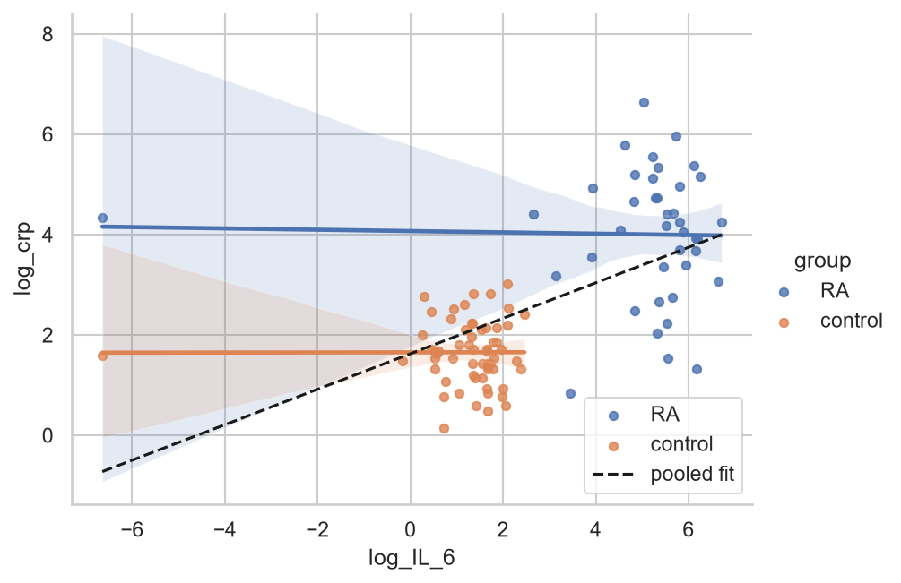
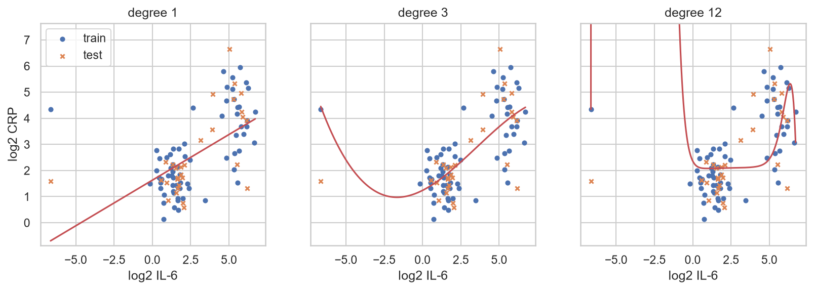
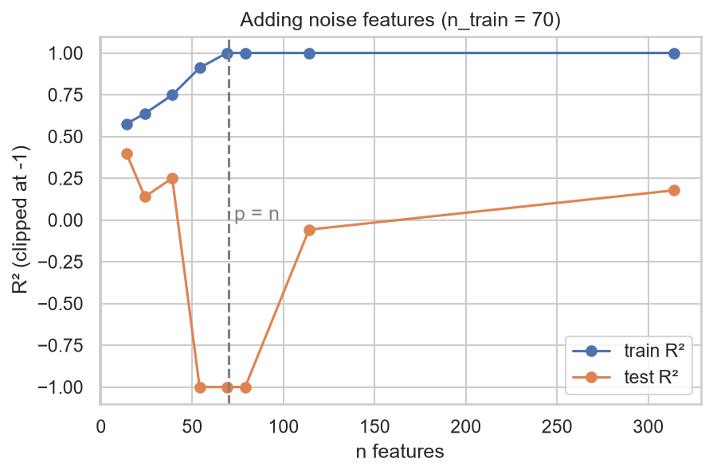
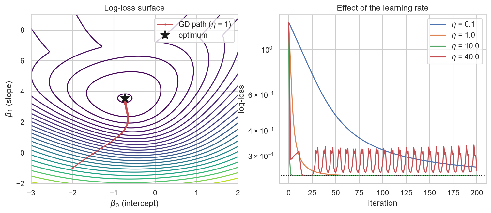
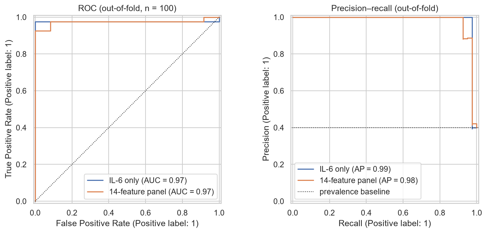
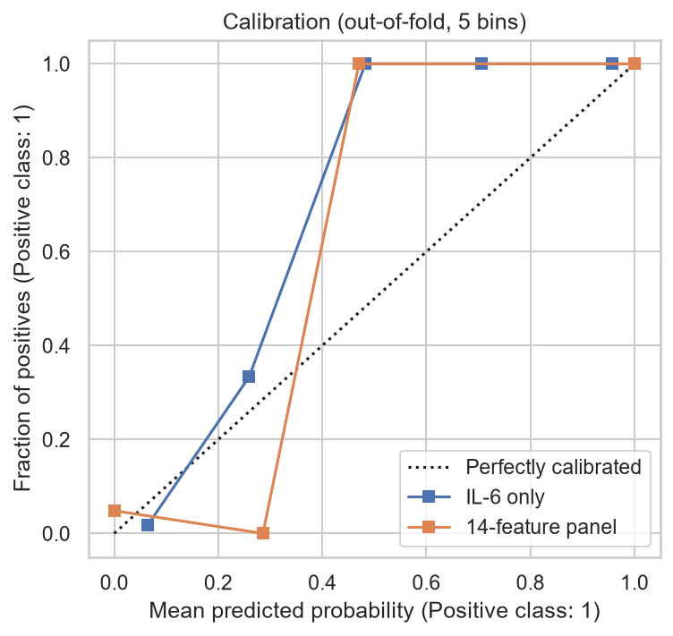
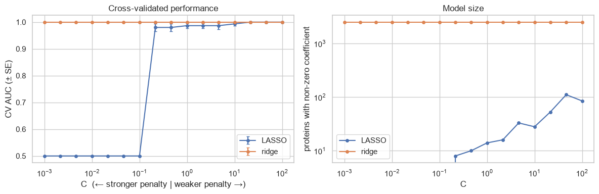
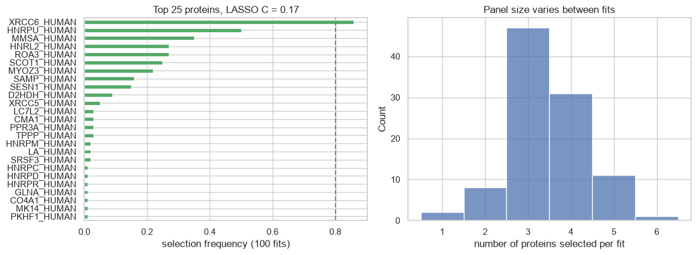
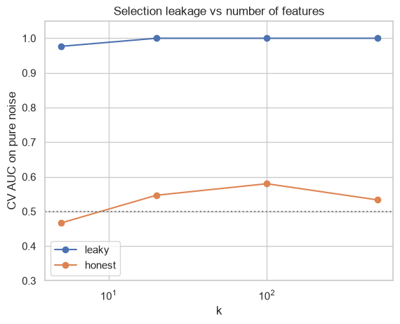

# ML Dojo

An attempt to **consolidate multiple courses, repositories and examples on traditional ML methods I gather over the years** and to work through them practically. The examples are tailored to **bioinformatics and clinical systems biology**: biomarker panels, patient cohorts, and omics-style data where features far outnumber samples.

## Layout

```
ml-dojo/
├── pyproject.toml, uv.lock   one shared environment for everything
├── primer/                   an attempt to build a basic course ahead of 2026' workshop (Day 1, 2, …)
├── workshop_2026/            additional workshop material and extensions
├── data/                     shared data (only the datasets used by primer/ are tracked)
└── docs/figures/             images for this README
```

## Notebooks (`primer/`)

| # | Notebook | Topics |
|---|---|---|
| 1 | [Fundamentals + linear regression](primer/day1_fundamentals_linear_regression.ipynb) | ML vocabulary, least squares by hand, confounding, train/test split, overfitting, the p ≫ n problem |
| 2 | [Logistic regression + gradient descent](primer/day2_logistic_regression_gradient_descent.ipynb) | odds ratios, log-loss, gradient descent from scratch, sensitivity/specificity, ROC/PR, calibration, target leakage |
| 3 | [Model performance + regularization](primer/day3_model_performance_regularization.ipynb) | cross-validation schemes, ridge vs LASSO, coefficient paths, nested CV, selection leakage, signature stability, permutation tests |

More notebooks will follow.

### Gallery

<table>
  <tr>
    <td width="33%"><br><sub><b>Day 1:</b> a strong pooled correlation that vanishes within groups (confounding)</sub></td>
    <td width="33%"><br><sub><b>Day 1:</b> more flexibility, more overfitting</sub></td>
    <td width="33%"><br><sub><b>Day 1:</b> adding noise features: train R² → 1, test R² collapses at p ≈ n</sub></td>
  </tr>
  <tr>
    <td><br><sub><b>Day 2:</b> gradient descent from scratch, and what the learning rate does</sub></td>
    <td><br><sub><b>Day 2:</b> out-of-fold ROC and precision–recall curves</sub></td>
    <td><br><sub><b>Day 2:</b> are the predicted probabilities trustworthy?</sub></td>
  </tr>
  <tr>
    <td><br><sub><b>Day 3:</b> ridge vs LASSO across penalty strengths, 2,509 proteins and 23 donors</sub></td>
    <td><br><sub><b>Day 3:</b> how stable is a LASSO "biomarker signature"?</sub></td>
    <td><br><sub><b>Day 3:</b> selecting features outside CV makes pure noise look perfect</sub></td>
  </tr>
</table>

## Data

- **Days 1–2:** a **simulated** ELISA cytokine dataset of rheumatoid arthritis patients vs healthy controls, n = 100 (`data/biomarker-analyses/elisa_biomarker_analysis_qmd/data/`).
- **Day 3:** a **published** proteomics table (PubMed ID 31642809) comparing donors aged 80+ with donors aged 20–34: 23 samples × 2,509 proteins, already log-transformed (`data/biomarker-analyses/legacy code/`).

No identifiable patient data is included.

## Getting started

The environment is managed with [uv](https://docs.astral.sh/uv/):

```bash
uv sync
```

See [SETUP.md](SETUP.md) for a short uv tutorial and instructions for running the notebooks in [Positron](https://positron.posit.co/).
